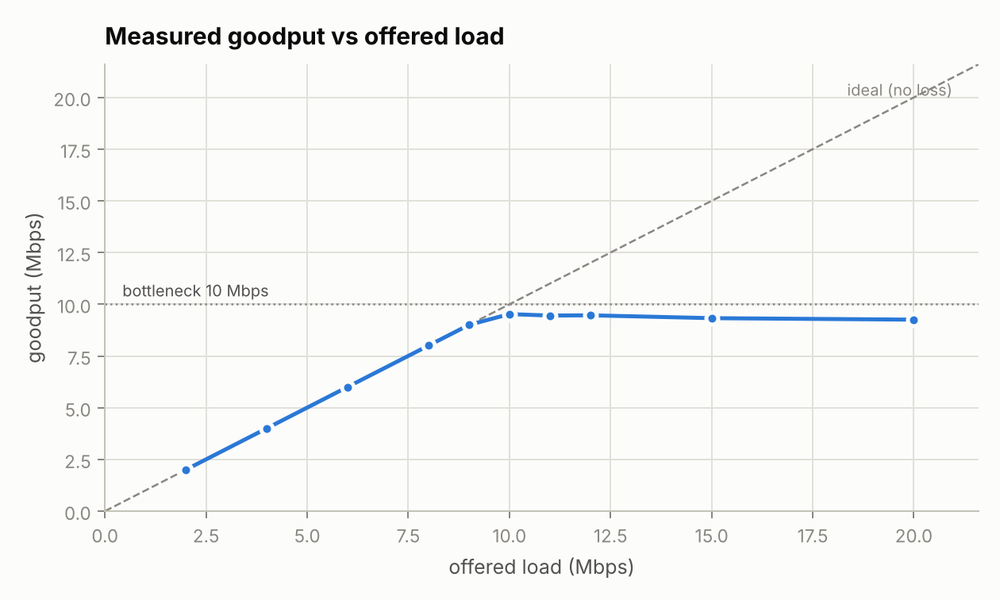
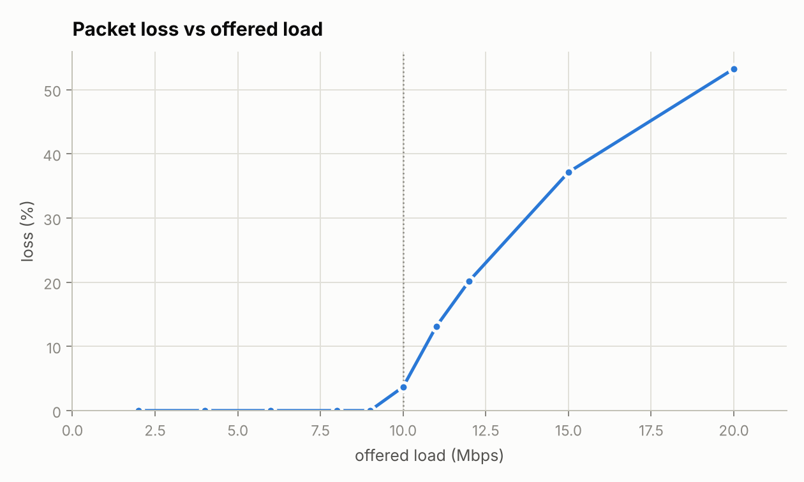
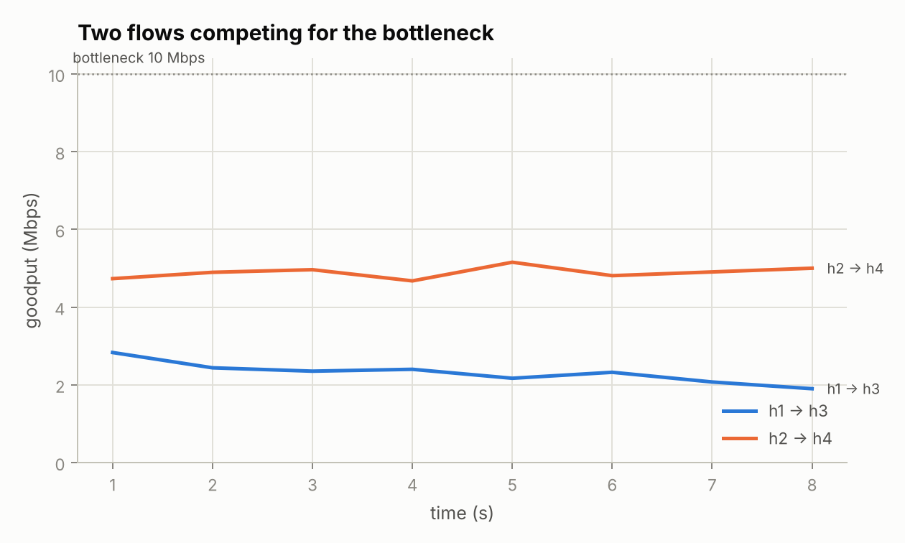
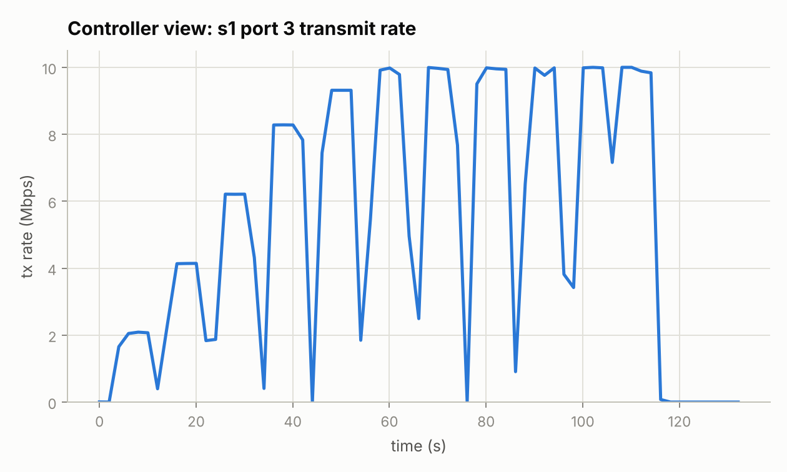

# SDN Bandwidth Meter and Traffic Analyzer

A UDP-based bandwidth measurement tool and an OpenFlow traffic analyzer, run on an emulated SDN network (Mininet + Open vSwitch + Ryu).

**Pala Gaurav Reddy** · PES1UG25AM254 · Computer Networks mini project, PES University

---

## What it does

Two independent views of the same traffic, which can be checked against each other:

| View | Where it runs | What it measures |
|---|---|---|
| **End-to-end (application)** | UDP sender/receiver on the hosts | goodput, packet loss, reordering, RFC 3550 jitter, one-way delay |
| **In-network (controller)** | Ryu app polling the switches | per-port Mbps, per-flow Mbps (5-tuple), protocol mix, drops |

The test network is a dumbbell with one deliberately narrow link, so the tool has a known capacity to discover:

```
h1 ─┐                          ┌─ h3
    s1 ════ bottleneck ════ s2
h2 ─┘    (10 Mbps default)     └─ h4
         host links 100 Mbps
```

## Repository layout

```
app/
  proto.py          wire format (20-byte header: magic, test id, seq, timestamp) + control messages
  udp_sender.py     paced UDP traffic generator
  udp_receiver.py   UDP sink + TCP control server, computes all end-to-end metrics
  ctrl_client.py    orchestrates a run: START -> send traffic -> STOP -> collect REPORT
controller/
  bw_monitor.py     Ryu app: learning switch, 5-tuple flows, port/flow stats polling, CSV logs
topology/
  topo.py           dumbbell topology, opens the Mininet CLI
  run_experiments.py  automated E1/E2/E3 experiment suite
analysis/
  analyze.py        plots + summary table from results/
results/            data, plots and controller logs from the run reported below
```

## How it works

**Measurement protocol.** The client opens a TCP control connection to the receiver and sends `START(test_id)`. Once the receiver answers `READY`, the client sends UDP datagrams at the target rate. Each datagram carries a sequence number and send timestamp. The client then sends `STOP(packets_sent)`, the receiver waits 0.5 s for in-flight packets, and replies with a JSON `REPORT`. Separating control (TCP, reliable) from data (UDP, unreliable) means the report itself can never be lost to the congestion it is measuring.

**Pacing.** Packet *i* is scheduled at `t0 + i·gap` with `gap = size·8 / rate`. The sender sleeps while ahead of schedule and sends back-to-back when behind, so the long-run rate stays on target despite coarse OS sleep granularity.

**Metrics (receiver).**
- Goodput = payload bytes received / receive window, plus a 1 s time series
- Loss = packets sent (reported by the client) − unique packets received
- Jitter: RFC 3550 estimator on transit-time differences, `J ← J + (|D| − J)/16`
- One-way delay = arrival − send timestamp. Valid in Mininet because all hosts share one kernel clock

**Controller.** For IPv4 traffic the Ryu app installs flows matching the full 5-tuple, so every conversation gets its own counters. Every 2 s it polls `OFPPortStatsRequest` and `OFPFlowStatsRequest` and computes rates from byte-counter deltas over the switch-reported durations, which removes the controller's own polling jitter. ARP is forwarded with packet-out only, so a MAC-only entry never hides reverse-direction IP traffic from flow accounting.

## Running it

Tested on Ubuntu with Mininet 2.3, Open vSwitch 3.3 and Ryu 4.34. Ryu needs Python 3.8 or 3.9.

```bash
# one-time setup
sudo apt install mininet openvswitch-switch ethtool
python3.9 -m venv ryuenv && source ryuenv/bin/activate
pip install "setuptools==57.5.0" wheel
pip install --no-build-isolation -r requirements.txt

# terminal 1: controller
ryu-manager controller/bw_monitor.py --ofp-tcp-listen-port 6633

# terminal 2: full experiment suite, then plots
sudo python3 topology/run_experiments.py --bw 10 --duration 10
python3 analysis/analyze.py
```

Interactive use:

```bash
sudo python3 topology/topo.py
mininet> h3 python3 app/udp_receiver.py &
mininet> h1 python3 app/ctrl_client.py --server 10.0.0.3 --rates 5 10 15
```

If OVS has no kernel module (WSL, containers, some VMs), add `--userspace`. TX checksum offload is then switched off on the hosts automatically, since otherwise TCP silently fails while ping still works. Link delay and queue limits need the `netem` qdisc; use `--delay 0ms --queue 0` if your kernel lacks it.

## Results

Run: 10 Mbps bottleneck, 1200-byte datagrams, 8 s per test, userspace OVS, no added delay. Raw data in `results/`.

**E1: rate sweep h1 → h3**

| offered (Mbps) | goodput (Mbps) | loss (%) | jitter (ms) |
|---:|---:|---:|---:|
| 2 | 2.00 | 0.00 | 0.077 |
| 6 | 6.00 | 0.00 | 0.138 |
| 9 | 9.00 | 0.00 | 0.132 |
| 10 | 9.53 | 3.70 | 0.127 |
| 12 | 9.47 | 20.21 | 0.343 |
| 15 | 9.33 | 37.14 | 0.400 |
| 20 | 9.26 | 53.24 | 0.183 |




**E2: two 8 Mbps flows sharing the bottleneck**: h1→h3 got 2.3 Mbps, h2→h4 got 4.9 Mbps.



**E3: same-switch control (h1 → h2, no bottleneck)**: 20 and 50 Mbps offered, both delivered with 0% loss.

**Controller view of the bottleneck egress port**



## What the numbers say

1. **Capacity knee at 10 Mbps.** Goodput tracks offered load up to 9 Mbps, then flattens. Every Mbps above capacity becomes loss, so loss ≈ 1 − C/offered (20 Mbps offered → ~53% lost).
2. **Goodput plateaus at ~9.5, not 10 Mbps.** The link shapes Ethernet frames; the receiver counts UDP payload. 1200 B payload rides in a 1242 B frame (UDP 8 + IP 20 + Ethernet 14), and 10 × 1200/1242 = 9.66 Mbps. The controller, which counts frame bytes, sees the port at ~10 Mbps. The two views agree once headers are accounted for.
3. **Jitter peaks around the knee, then falls.** Near capacity the queue alternately fills and drains, so spacing between arrivals varies. Far above capacity the queue stays full and the link drains it at a constant rate, so arrivals become evenly spaced again.
4. **UDP gets no fair share.** Two identical flows split the bottleneck roughly 1:2. UDP has no congestion control and a drop-tail FIFO drops whatever arrives when the queue is full, so the split depends on burst timing, not fairness. This is exactly why TCP congestion control or fair queueing (FQ-CoDel, per-flow meters in OpenFlow) exist.

## Limitations

- Python pacing tops out at a few hundred Mbps; fine for this topology, not for 10 G links.
- One-way delay is only meaningful on a shared clock (Mininet). Across real machines use RTT or PTP-synced clocks.
- Controller rates are averages over the polling interval (2 s), so short bursts are smoothed out.

## Possible extensions

- Per-flow OpenFlow meters to enforce fair sharing, then rerun E2
- Add TCP flows and compare against UDP under the same bottleneck
- Packet-pair or pathload-style capacity estimation without saturating the link
